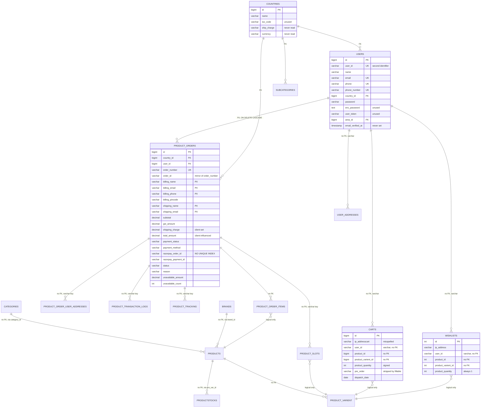
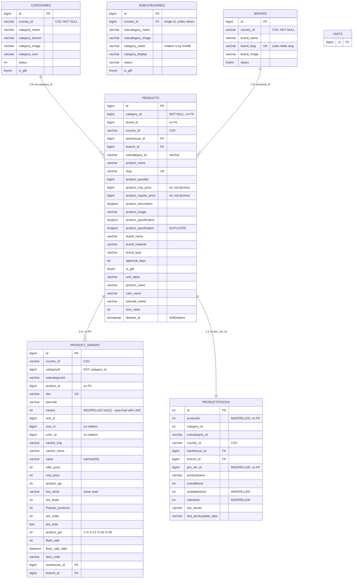
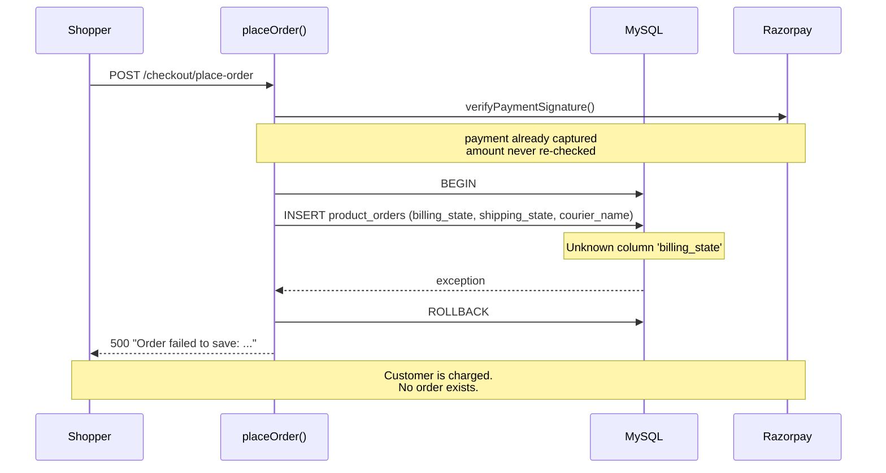
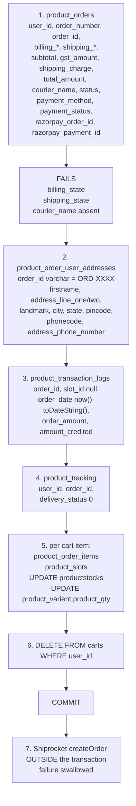
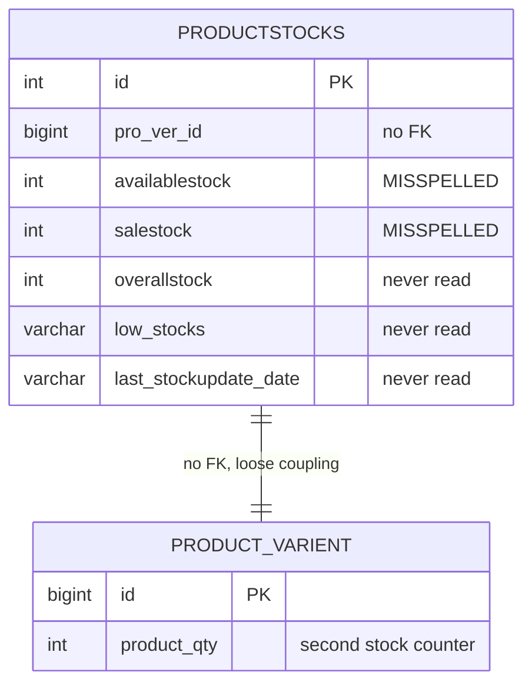
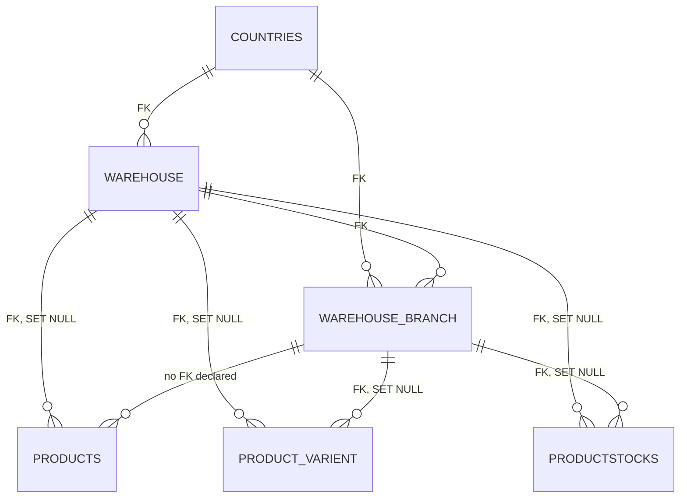
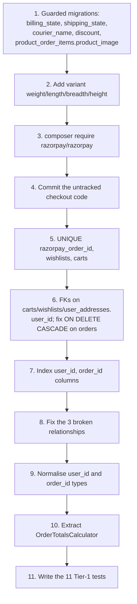

# 26 — Data Model Diagram

Mermaid diagrams derived from `palvarnan_db (2).sql` (93 tables, 34 FKs, 19 unique indexes — all enumerated directly) and the 24 models in `app/Models/`.

Render in any Mermaid-capable viewer: GitHub, VS Code, mermaid.live.

---

## 1. ER overview — the live commerce path

Solid arrows are **real** foreign keys or working Eloquent relations. Dashed arrows are **logical only** — no constraint, no relation, or a broken one.



### What the diagram shows

**Every arrow on the money path is dashed.** `product_orders` is the only order table with a real FK — and it cascades to `users`, so deleting a user destroys order history.

---

## 2. Catalogue



### Defects marked inline

| Marker | Defect | ID |
|---|---|---|
| `offer_price` / `mrp_price` in `Product::$fillable` | **not `products` columns** — writes are silently dropped | DB-17 |
| `products.product_price` read at 6 sites | **does not exist**; chain falls to `0` | DB-16 |
| `product_mrp_price bigint` | money stored as an integer column | DB-27 |
| no `weight`/`length`/`breadth`/`height` | **shipping quoted on a fictional 12 kg parcel** | DB-04 |
| `varient int(11)` | `LIKE` search can never match | D-S3 |
| `categoryid` vs `category_id` | `ProductVarient::category()` broken | DB-09 |
| `category_name` on `sub_categories` | `SubCategory::category()` broken | DB-08 |
| `country_id` CSV on 5 tables, FK on 5 others | two incompatible designs | DB-18 |
| `product_specfication` | duplicate of `product_specification` | DB-22 |
| `productstocks.productid` + `pro_ver_id` | two misspelled links to the same parents | — |

---

## 3. Order transaction — what `placeOrder()` actually writes

Six tables, one transaction, one rollback. This is the sequence that fails.





### The three insert points that fail

| Step | Table | Absent columns | Evidence |
|---|---|---|---|
| 1 | `product_orders` | `billing_state`, `shipping_state`, `courier_name` | `Unknown column 'billing_state'` |
| 5 | `product_order_items` | `product_image` | `Unknown column 'product_image'` |
| — | — | never reached | — |

### Identifier split across the six writes

| Table | `order_id` type | Value written |
|---|---|---|
| `product_order_items` | `bigint` | `$order->id` |
| `product_order_user_addresses` | `varchar(255)` | `'ORD-XXXX'` |
| `product_transaction_logs` | `varchar(255)` | `'ORD-XXXX'` |
| `product_tracking` | `varchar(255)` | `'ORD-XXXX'` |
| `product_slots` | `varchar(255)` | `'ORD-XXXX'` |

**One order has two identifiers, and only one is joinable.** `ProductOrder::items()` works because the code writes `$order->id`; `ProductOrder::trackings()` works because it writes the string form. No FK enforces either.

---

## 4. Stock flow



`CheckoutController.php:403-415` decrements **two independent counters**:

```php
$productStock->availablestock = max($productStock->availablestock - $qty, 0);
$productStock->salestock      = ($productStock->salestock ?? 0) + $qty;

$variant->product_qty = max($variant->product_qty - $qty, 0);
```

| Defect | Detail |
|---|---|
| no `lockForUpdate()` | two concurrent checkouts both read the same stock |
| `max(..., 0)` | **oversell is silent** — stock reads 0 while units keep shipping |
| `product_qty` is never initialised | a new variant defaults to `null`; `null - 5` is `-5` |
| no stock restore | no cancel or return path exists |
| `overallstock`, `low_stocks`, `last_stockupdate_date` | never written |
| `ProductStock::where('pro_ver_id', …)->first()` | picks one row arbitrarily where a variant spans warehouses |

---

## 5. Address and geography

```mermaid
erDiagram
    USER_ADDRESSES {
        bigint id PK
        varchar user_id "varchar, no FK"
        varchar address_username "never written"
        varchar address_first_name
        varchar address_last_name "varchar(20)"
        varchar address_phone_number bigint "phone stored in int column"
        varchar email
        longtext address_line_one
        longtext address_line_two
        longtext landmark
        bigint area_id "no FK, used as country FK in code"
        varchar area_name "never written"
        longtext city
        int city_id "never written"
        int state_id "never written"
        int pincode "no format validation"
        int pincode_id "never written"
        varchar district "never written"
        varchar state "varchar(225)"
        varchar phone_code "never written"
        bigint address_type_id
        varchar address_type_name
        varchar address_type_others_name
    }
    COUNTRIES {
        bigint id PK
        varchar name
        varchar iso_code
        varchar phone_code
        varchar ship_charge "never read"
        varchar currency "never read"
    }
    STATES {
        int id PK
        varchar name "varchar(30)"
        int country_id
        varchar shipping_charge "read only by dead endpoint"
        decimal express_shipping_charge "never read"
    }
    DISTRICTS {
        bigint id PK
        varchar name
        int state_id
        varchar state_name "relation is by NAME"
    }
    AREAS {
        bigint id PK
    }
    COUNTRIES ||--o{ USER_ADDRESSES : "no FK - country() uses area_id"
    DISTRICTS ||--o{ USER_ADDRESSES : "no FK"
    AREAS ||--o{ USER_ADDRESSES : "no FK declared"
    COUNTRIES ||--o{ STATES : "no FK"
    STATES ||--o{ DISTRICTS : "no FK"
```

| Defect | Detail |
|---|---|
| `UserAddress::country()` uses `area_id` | points at `areas`, not `countries` |
| `address_phone_number bigint` | a phone number in an integer column |
| `state varchar(225)` | a typo for `255`; wider than `states.name varchar(30)` |
| `address_last_name varchar(20)` | truncates |
| `getCitiesByState()` | `District::where('state_name', …)` — joins by name, no FK |
| `getShippingCharge()` | `State::where('name', …)` — no caller |
| `countries.currency`, `ship_charge` | never read; the UI hard-codes `₹` |
| `is_default` | **does not exist**; no default-address concept |
| `user_default_address_id` on `users` | never written |

---

## 6. Warehousing (referenced, never used)



**The only tables in the schema with real, cascading warehouse constraints — and the storefront reads none of them.** `warehouse_id` and `branch_id` sit in `$fillable` on three models and are never populated. So `ProductStock::where('pro_ver_id', …)->first()` always resolves against rows with `warehouse_id = NULL`.

---

## 7. Tables with no storefront usage (~55)

| Group | Tables | Present in schema as |
|---|---|---|
| Milk / subscription | `milk_orders`, `milk_order_user_addresses`, `milk_slots`, `milk_refunds`, `milk_transaction_logs`, `plan_types`, `onetimes` | a second business, unimplemented |
| Gifts | `gift_purchase_orders`, `gift_purchase_order_items`, `gift_color`, `gift_size` | template leftovers |
| Procurement | `purchase_orders`, `purchase_order_items`, `product_stock_batches`, `stock_distributions`, `stock_transfers`, `supplier_details` | dashboard domain |
| Delivery | `delivery_people`, `delivery_charge_details` | dashboard domain |
| Promotions | `coupons`, `newcoupons`, `offer_images`, `today_deals`, `testimonials`, `reviews`, `home_promotions` | no storefront UI |
| Content | `banner_images`, `web_images`, `scrolling_bars`, `contacts`, `contact_details`, `bulkorders` | dashboard domain |
| Auth | `dashboard_users`, `roles`, `permissions`, `role_has_permissions`, `model_has_roles`, `model_has_permissions`, `personal_access_tokens`, `otps`, `mail_otps` | admin only |
| Notifications | `notifications`, `app_notifications`, `app_alerts`, `user_read_notifications` | no mailers exist |
| Geography extras | `cities`, `city_list`, `state_list`, `all_india_pincodes`, `country_tables`, `free_shipping_settings`, `address_types`, `gender_types` | partially referenced |
| Observability | `telescope_entries`, `telescope_entries_tags`, `telescope_monitoring`, `tests` | Telescope not installed |
| Warehouse | `warehouse`, `warehouse_branch` | FKs only, never read |
| Coupons | `cancel_requests`, `product_refunds` | no code path |

### Tables that do **not** exist, contrary to earlier design notes

`api_logs`, `shiprocket_orders`, `shiprocket_pickup_locations`, `product_transactions`, `product_order_status`, `order_tracking`, `productcategories`, `productpictures`, `product_varient_pictures`, `productstocksprices`, `product_offers`, `offers`, `compare`, `attributes`, `attr_values`, `variants_attributes`, `pincodes`, `posts`, `pages`, `banners`, `shipping_methods`, `shipping_zones`, `country_shipping`, `shipments`, `shipment_items`, `returns`, `return_items`, `order_status_logs`, `coupon__product`, `coupon__product_varient`, `membership_plans`, `user_role`, `product_invoice`, `product_return_requests`, `gift_token`.

**There is no integration-audit table.** Shiprocket and Razorpay traffic exists only in `storage/logs/laravel.log`.

---

## 8. Model-to-table map (24 models, 24 tables)

| Model | Table | `$table` declared? | Defects |
|---|---|---|---|
| `User` | `users` | default | `MustVerifyEmail` commented out; `enc_password`, `user_token` unused |
| `UserAddress` | `user_addresses` | yes | `country()` uses `area_id` — broken |
| `Country` | `countries` | yes | `ship_charge`, `iso_code` never read |
| `State` | `states` | yes | `name` only, `shipping_charge` read by dead code |
| `District` | `districts` | yes | `state_name` used as a join key |
| `Area` | `areas` | default | unused |
| `AreaAssign` | `area_assigns` | default | unused |
| `Cart` | `carts` | default | `pre_order` stripped |
| `Wishlist` | `wishlists` | yes | no `user()` relation; `ip_address` vs `ip_addresscart` |
| `Product` | `products` | default | `SoftDeletes`; `offer_price`/`mrp_price` not columns; `variants()` + `productvari()` |
| `ProductVarient` | `product_varient` | yes | `category()` uses `category_id` instead of `categoryid` |
| `ProductStock` | `productstocks` | yes | misspelled attribute access |
| `ProductOrder` | `product_orders` | yes | 14 `$fillable` columns absent from the dump; timestamps fillable; `user()` + `customer()` |
| `ProductOrderItem` | `product_order_items` | yes | `product_image` written, column absent |
| `ProductOrderUserAddress` | `product_order_user_addresses` | yes | keyed on the varchar `order_id` |
| `ProductTransactionLog` | `product_transaction_logs` | yes | no gateway reference — not a payment record |
| `ProductTracking` | `product_tracking` | default | keyed on the varchar `order_id` |
| `ProductSlot` | `product_slots` | yes | keyed on the varchar `order_id` |
| `Category` | `categories` | default | `subCategories()` uses a non-existent FK; no `slug` |
| `SubCategory` | `sub_categories` | default | `category()` FK does not exist |
| `Brand` | `brands` | default | code reads `slug`, column is `brand_slug` |
| `Unit` | `units` | default | fine |
| `Coupon` | `coupons` | yes | never queried |
| `HomePromotion` | `home_promotions` | default | never queried |

---

## 9. Fix order for the model



Steps 1-2 are revenue-blocking. Step 2 in particular fixes shipping quotes that are currently wrong for every order.

---

## 10. Related documents

- [07-database-schema.md](07-database-schema.md) — table-by-table reference
- [11-models-and-relationships.md](11-models-and-relationships.md) — Eloquent detail
- [22-database-integrity.md](22-database-integrity.md) — constraints and migrations
- [26-data-model-diagram.md](26-data-model-diagram.md) — this document
- [29-remediation-plan.md](29-remediation-plan.md) — the fix sequence