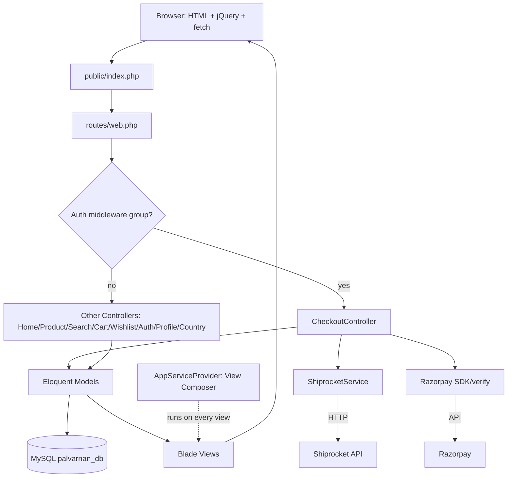

# ARCHITECTURE.md

**Purpose:** Request lifecycle, MVC layering, service layer (only `ShiprocketService`), absence of
repositories/policies/form-requests, `queue=sync`, no scheduler. Mermaid diagram allowed.

---

## 1. Architectural style

This is a **monolithic, server-rendered Laravel 12 application** following Laravel's conventional MVC
structure. Business logic lives largely **inline in controllers**. There is **no Clean/DDD layer split**.

Confirmed absences: **no Repositories**, **no Policies/Gates**, **no Form Request classes**, **no API Resources**,
**no `app/Http/Middleware` directory**. The only "service" class is [`ShiprocketService.php`](../../app/Services/ShiprocketService.php)
(an HTTP wrapper for Shiprocket API). `VERIFIED_FROM_SOURCE` — see [`../02-architecture.md:7-15`](../02-architecture.md#1-architectural-style--what-it-actually-is).

---

## 2. Request lifecycle (as implemented)

```text
Browser → public/index.php → Laravel bootstrap (bootstrap/app.php)
  → routes/web.php → middleware (Laravel defaults + trustProxies*)
    → Controller method (inline business logic)
      → Eloquent Models (reads/writes to MySQL)
        → Blade views (server-rendered HTML)
          → Response to browser
```

Notes:
- Middleware stack: Laravel 12 uses `bootstrap/app.php` to register middleware; global middleware not customized
  beyond `trustProxies(at: '*')` ([`bootstrap/app.php:13-15`](../../bootstrap/app.php#L13-L15)).
- Routes: 45 in [`routes/web.php`](../../routes/web.php); ~10 behind `auth` group ([`routes/web.php:71-83`](../../routes/web.php#L71-L83)).
- View composer: [`AppServiceProvider::boot()`](../../app/Providers/AppServiceProvider.php#L25-L78) runs on **every view**
  and queries cart/wishlist counts/subtotal (guest or auth). `VERIFIED_FROM_SOURCE`.

See also [`../02-architecture.md:16-70`](../02-architecture.md#2-request-lifecycle-the-true-path) for a detailed diagrammatic description.

---

## 3. MVC layering

| Layer | What exists | Notes |
|---|---|---|
| **Route** | [`routes/web.php`](../../routes/web.php) (45), [`routes/console.php`](../../routes/console.php) | Console has only inspire command. `VERIFIED_FROM_SOURCE` |
| **Controller** | 10 controllers in [`app/Http/Controllers/`](../../app/Http/Controllers) | `CheckoutController.php:701` lines is the largest; business rules inline. `VERIFIED_FROM_SOURCE` |
| **Model** | 25 Eloquent models in [`app/Models/`](../../app/Models) | Many `$fillable` lists reflect legacy schema; relations vary. `VERIFIED_FROM_SOURCE` |
| **View** | 23 Blade views in [`resources/views/`](../../resources/views) | Layout [`layouts/app.blade.php`](../../resources/views/layouts/app.blade.php) composed with header/footer/country-modal. `VERIFIED_FROM_SOURCE` |

**No dedicated middleware classes** in `app/Http/Middleware` (directory absent). Authorization is ad hoc (e.g.
`abort_unless($address->user_id === Auth::id(), 403)` in [`CheckoutController.php:596,629`](../../app/Http/Controllers/CheckoutController.php#L596-L629)).
No route-level policy checks. `VERIFIED_FROM_SOURCE`.

---

## 4. Service layer

- **Only one service:** [`app/Services/ShiprocketService.php`](../../app/Services/ShiprocketService.php)
  - Methods: `getToken`, `checkServiceability`, `createOrder`, `assignAWB`, `generatePickup`, `generateManifest`,
    `printManifest`, `generateLabel`, `printInvoice`, `trackAWB`, `getPickupLocations`. `VERIFIED_FROM_SOURCE`
- Used by [`CheckoutController`](../../app/Http/Controllers/CheckoutController.php):
  - `getShiprocketCouriers()` calls `shiprocket->checkServiceability()` ([`CheckoutController.php:124`](../../app/Http/Controllers/CheckoutController.php#L124))
  - `placeOrder()` calls `shiprocket->createOrder()` ([`CheckoutController.php:498`](../../app/Http/Controllers/CheckoutController.php#L498))
    and optionally `assignAWB()` ([`CheckoutController.php:510`](../../app/Http/Controllers/CheckoutController.php#L510))
- **No other services.** Business logic (pricing, totals, stock deduction, multi-table order write) is inline
  in [`CheckoutController::placeOrder()`](../../app/Http/Controllers/CheckoutController.php#L225-L535).
  `VERIFIED_FROM_SOURCE`.

**Uncalled service method:** `generatePickup()` exists ([`ShiprocketService.php:119-124`](../../app/Services/ShiprocketService.php#L119-L124))
but has **no caller** anywhere in `app/`. (Earlier docs referred to `createPickup()` name; that method does not exist —
behaviourally pickup is never scheduled.) `VERIFIED_FROM_SOURCE`, `CONFLICTING_EVIDENCE` vs naming in audit.

---

## 5. Absences (repositories, policies, form-requests)

| Artefact | Status | Evidence |
|---|---|---|
| Repositories | **None** | No `app/Repositories/` directory. `VERIFIED_FROM_SOURCE` |
| Policies/Gates | **None** | No `app/Policies/`. No `Gate::`/`Policy::` usage observed in code. `VERIFIED_FROM_SOURCE` |
| Form Request classes | **None** | No `app/Http/Requests/`. Validation is inline (`$request->validate()` or `Validator::make()`). `VERIFIED_FROM_SOURCE` |
| API Resources | **None** | Not present. All responses are JSON via `response()->json()` or Blade views. `VERIFIED_FROM_SOURCE` |
| Middleware classes | **None** (directory absent) | `app/Http/Middleware/` does not exist; middleware configured in `bootstrap/app.php`. `VERIFIED_FROM_SOURCE` |
| Scheduler | **None** | [`routes/console.php`](../../routes/console.php) has only `inspire`; no `Schedule::` definitions. `VERIFIED_FROM_SOURCE` |

---

## 6. Queues, background jobs, scheduler

- Queue driver: `QUEUE_CONNECTION=sync` in current [`.env`](../../.env) → **sync**. Jobs execute synchronously.
  `VERIFIED_FROM_SOURCE`. (Existing audit noted `database` driver in its snapshot; current `.env` differs —
  `CONFLICTING_EVIDENCE`.)
- No queued jobs defined in codebase (no job classes in `app/Jobs/` directory observed in app listing; only stock
  migrations include jobs table). `VERIFIED_FROM_SOURCE`.
- **No scheduler.** `routes/console.php` has only the inspire command. `VERIFIED_FROM_SOURCE`.

---

## 7. Database ownership model (cross-project)

- Both `palVarnan` and `palVarnanDashboard` connect to **same MySQL DB**: `palvarnan_db`
  ([`.env`](../../.env), [`../01-project-inventory.md:36`](../01-project-inventory.md#1-what-kind-of-project-is-this)).
- **Storefront has 0 domain migrations**; only 3 stock Laravel migrations
  ([`database/migrations/`](../../database/migrations)). Dashboard owns schema/migrations. `VERIFIED_FROM_SOURCE`.
- This means deploy order and schema evolution are coupled to the dashboard app. `INFERRED`.

---

## 8. High-level system diagram (Mermaid)



Notes on diagram elements: only `ShiprocketService` in `app/Services/`; no middleware classes (auth is route group);
queue is sync; no scheduler. `VERIFIED_FROM_SOURCE`.

---

## 9. Related

- [`../02-architecture.md`](../02-architecture.md)
- [`PROJECT_STRUCTURE.md`](./PROJECT_STRUCTURE.md)
- [`BUSINESS_LOGIC.md`](./BUSINESS_LOGIC.md)
- [`../12-services-and-integrations.md`](../12-services-and-integrations.md)
- [`../08-business-logic.md`](../08-business-logic.md)