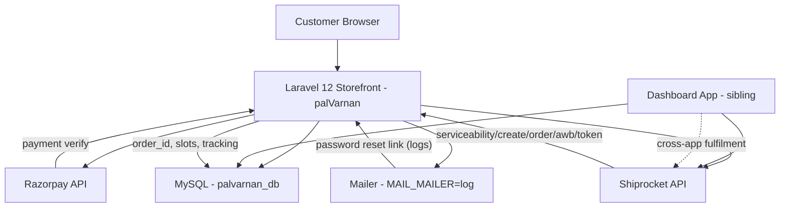

# Integration Map — Project B (`palVarnan`)

> Source-verified mapping of Razorpay, Shiprocket, configuration keys, and shared-DB
> coupling with the dashboard app. Evidence vocabulary: `VERIFIED_FROM_SOURCE`,
> `VERIFIED_FROM_LIVE_SCHEMA`, `INFERRED`, `UNVERIFIED`, `NOT_AVAILABLE`,
> `CONFLICTING_EVIDENCE`. **No credentials or PII are reproduced.**
>
> Siblings: [`./ROUTES_AND_API_REFERENCE.md`](./ROUTES_AND_API_REFERENCE.md),
> [`./CONTROLLER_REFERENCE.md`](./CONTROLLER_REFERENCE.md),
> [`./FRONTEND_REFERENCE.md`](./FRONTEND_REFERENCE.md),
> [`./SECURITY_AUDIT.md`](./SECURITY_AUDIT.md).
> Existing narrative: [`../23-external-services.md`](../23-external-services.md),
> [`../12-services-and-integrations.md`](../12-services-and-integrations.md),
> [`../09-dependencies.md`](../09-dependencies.md).

---

## 1. Integration overview

| Integration | Purpose | Protocol | Auth | Where it lives | Status |
|---|---|---|---|---|---|
| Razorpay | Payment (order creation + signature verify) | HTTPS (api.razorpay.com) | HMAC (key/secret) | `CheckoutController::preparePayment()` and `::placeOrder()`; SDK from `razorpay/razorpay ^2.9` | **Verified working** in app code; dependency now declared in `composer.json` |
| Shiprocket | Fulfilment: serviceability, order creation, AWB assign, token | HTTPS (apiv2.shiprocket.in) | Bearer token (cached) + HTTP Basic login | `app/Services/ShiprocketService.php` + `CheckoutController::placeOrder()` and `::getShiprocketCouriers()` | **Partially working** — 7 of 11 service methods have **no callers** |
| `MAIN_URL` | Image base URL for search results | string | none | `SearchController.php:23` | Uses `env('MAIN_URL')` directly — breaks under `config:cache` |
| Mailer | Password reset (`Password::sendResetLink`) | SMTP/driver | driver-dependent | `AuthController::forgotPassword()` | `MAIL_MAILER=log` — mails go to `storage/logs/laravel.log` |

`VERIFIED_FROM_SOURCE`.

---

## 2. Razorpay

### 2.1 Configuration keys

| Key | Where | Line | Evidence |
|---|---|---|---|
| `RAZORPAY_KEY` | `.env` | `:69` | `VERIFIED_FROM_SOURCE` (`.env` grep) |
| `RAZORPAY_SECRET` | `.env` | `:70` | `VERIFIED_FROM_SOURCE` (`.env` grep) |
| `services.razorpay.key/secret` | `config/services.php` | `:38-41` | `VERIFIED_FROM_SOURCE` (`config/services.php`) |
| `RAZORPAY_KEY/SECRET` | `.env.example` | **absent** | `VERIFIED_FROM_SOURCE` — not present |

No secrets reproduced.

### 2.2 Dependency (declared, SDK loaded locally)

| Item | Value | Evidence |
|---|---|---|
| Composer require | `"razorpay/razorpay": "^2.9"` | `composer.json:12` `VERIFIED_FROM_SOURCE` |
| Composer lock | present for the package | `composer.lock` (`VERIFIED_FROM_SOURCE` per `VERIFIED_FACTS.md`) |
| Fallback `require_once` | `vendor/razorpay/razorpay/Razorpay.php` if class not found | `CheckoutController.php:26-31` |
| Usage | `new Api(config('services.razorpay.key'), config('services.razorpay.secret'))` | `CheckoutController.php:199`, `:258` |

The manual require block exists but the package is now declared — the workaround is redundant.
`VERIFIED_FROM_SOURCE`.

### 2.3 Flow

| Step | Call site | Operation |
|---|---|---|
| Prepare | `CheckoutController::preparePayment()` `:172-220` | Recompute subtotal/GST from cart; read **`shipping_charge`** and **`coupon_discount`** from request (`:191-192`, `:286-288`); create order via `Api::order->create(['receipt'=>..., 'amount'=> (int) round(total*100), 'currency'=>'INR'])`; return JSON (includes `razorpay_key`) |
| Verify | `CheckoutController::placeOrder()` `:252-268` | When `payment_method == 'Online Payment'`, require `razorpay_payment_id`, `razorpay_signature`, `razorpay_order_id`; call `$api->utility->verifyPaymentSignature($attributes)` |
| Persist | `CheckoutController::placeOrder()` `:292-421` | DB transaction: `product_orders`, `product_order_user_addresses`, `product_transaction_logs`, `product_tracking`, `product_order_items`, `product_slots`, stock deduction, clear `carts`; `DB::commit()` |

**Key points:** `VERIFIED_FROM_SOURCE`.

- Subtotal/GST are **server-recomputed** in `preparePayment()` — not taken from the client.
- `shipping_charge` and `coupon_discount` are **client-supplied** and never validated; no
  coupon lookup exists. See **SEC-B-02**.
- `preparePayment()` computes `$total = max((subtotal+gst+shipping)-discount, 1)` (`:193`)
  while `placeOrder()` uses `(subtotal+gst+shipping)-discount` with **no floor** (`:288`) —
  two formulas. **CONFLICTING_EVIDENCE** (divergence) — see [`./SECURITY_AUDIT.md`](./SECURITY_AUDIT.md).
- Signature verification is correct; no re-verification of the amount/order binding in this
  code.

---

## 3. Shiprocket

### 3.1 Service class

`app/Services/ShiprocketService.php` — **200 lines** (public methods below). `VERIFIED_FROM_SOURCE`.

| # | Method | Lines | Purpose |
|---|---|---|---|
| SR1 | `getToken()` | `:25-47` | Login to `/auth/login`; `Cache::remember` 8h using `md5(email)` key; throws on failure |
| SR2 | `checkServiceability(array $params)` | `:63-77` | GET `/courier/serviceability`; logs error on failure; returns raw JSON |
| SR3 | `createOrder(array $orderData)` | `:85-98` | POST `/orders/create/adhoc`; logs error on failure; returns raw JSON |
| SR4 | `assignAWB(array $payload)` | `:106-111` | POST `/courier/assign/awb`; returns raw JSON (no logging) |
| SR5 | `generatePickup(array $payload)` | `:119-124` | POST `/courier/generate/pickup`; returns raw JSON (no logging) |
| SR6 | `generateManifest(array $payload)` | `:132-137` | POST `/manifests/generate`; returns raw JSON (no logging) |
| SR7 | `printManifest(array $payload)` | `:145-150` | POST `/manifests/print`; returns raw JSON (no logging) |
| SR8 | `generateLabel(array $payload)` | `:158-163` | POST `/courier/generate/label`; returns raw JSON (no logging) |
| SR9 | `printInvoice(array $payload)` | `:171-176` | POST `/orders/print/invoice`; returns raw JSON (no logging) |
| SR10 | `trackAWB($awbCode)` | `:184-189` | GET `/courier/track/awb/{awbCode}`; returns raw JSON (no logging) |
| SR11 | `getPickupLocations()` | `:194-199` | GET `/settings/company/pickup`; returns raw JSON (no logging) |
| — | `client()` (protected) | `:52-55` | `Http::withToken(getToken())->acceptJson()` |

**Configuration defaults:**
- `$this->baseUrl = config('services.shiprocket.base_url', 'https://apiv2.shiprocket.in/v1/external')` — `:15`
- Pickup location/pincode from `config('services.shiprocket.pickup_location')`, `pickup_pincode` — `:46-47` in config

**Observation:** **SR5 (generatePickup), SR6 (generateManifest), SR8 (generateLabel), SR10 (trackAWB), SR7, SR9, SR11 have NO callers in `app/`.** Only SR1–SR4 are called. `VERIFIED_FROM_SOURCE` (grep for method names over `app/`).

### 3.2 Configuration keys

| Key | Where | Line | Evidence |
|---|---|---|---|
| `SHIPROCKET_EMAIL` | `.env` | `:72` | `VERIFIED_FROM_SOURCE` |
| `SHIPROCKET_PASSWORD` | `.env` | `:73` | `VERIFIED_FROM_SOURCE` |
| `SHIPROCKET_PICKUP_LOCATION` | `.env` | `:74` | `VERIFIED_FROM_SOURCE` |
| `SHIPROCKET_PICKUP_PINCODE` | `.env` | `:75` | `VERIFIED_FROM_SOURCE` |
| `SHIPROCKET_BASE_URL` | `.env` | `:76` | `VERIFIED_FROM_SOURCE` |
| `services.shiprocket.base_url` | **not defined** in `config/services.php` | — | **grep returns no matches**; only read via `config(..., default)` — so `.env` value is **ignored** (`BUG-41` in `../23-external-services.md`). `VERIFIED_FROM_SOURCE`. |

No secrets reproduced.

`config/services.php` Shiprocket block: `:43-48` defines `email`, `password`,
`pickup_location`, `pickup_pincode` — missing `base_url`. `VERIFIED_FROM_SOURCE`.

### 3.3 Callers

| Method | Called from | Lines | Notes |
|---|---|---|---|
| `checkServiceability` | `CheckoutController::getShiprocketCouriers()` | `:124` | Builds `params` with `pickup_postcode`, `delivery_postcode`, `weight`, `cod`; returns mapped couriers |
| `createOrder` | `CheckoutController::placeOrder()` | `:498` | Builds full order payload; logs the entire payload at `info` level (`:497`) — see [`../13-security-audit.md`](../13-security-audit.md) SEC-18 |
| `assignAWB` | `CheckoutController::placeOrder()` | `:510-522` | Called only if `selected_courier_id` present; on 200 updates `awb_code`, `courier_name`, `shiprocket_status='AWB Assigned'` |

Shiprocket calls run **after** `DB::commit()` (`:421`) and are wrapped in `catch (\Exception)`
that only logs (`:525-527`) — fulfilment failure does not roll back the order.

**generatePickup**: the method exists but is **never called**. The behavioural claim "pickup is
never scheduled" holds for `generatePickup`. `VERIFIED_FROM_SOURCE`.

---

## 4. `MAIN_URL` image base (SearchController)

`SearchController.php:23` — `VERIFIED_FROM_SOURCE`:

```php
$baseImageUrl = rtrim(env('MAIN_URL'), '/') . '/images/';
```

| Item | Value | Evidence |
|---|---|---|
| Key in `.env` | `MAIN_URL` | `.env:6` |
| Read via | `env('MAIN_URL')` (direct) | `SearchController.php:23` |
| Used in | `GET /search` JSON: `image` for Product/Variant/Brand/Category | `SearchController.php:33-37`, `:49-57`, `:67-73`, `:82-87` |
| Risk | Returns `null` under `php artisan config:cache` (outside `config/`), collapsing to `/images/` | **SEC-B-06**; [`../13-security-audit.md`](../13-security-audit.md), [`../23-external-services.md`](../23-external-services.md) BUG-27 |

---

## 5. Mailer (password reset)

| Item | Value | Evidence |
|---|---|---|
| `MAIL_MAILER` | `log` | `.env:52` |
| `MAIL_*` config | present in `.env.example` (log) | `.env.example:50-57` |
| Usage | `Password::sendResetLink()` | `AuthController::forgotPassword()` `:81-83` |
| Consequence | Reset links go to `storage/logs/laravel.log` (not to user inbox) | **INFERRED** operational behaviour; `MAIL_MAILER=log` is confirmed |

Combined with the unauthenticated `/reset-password-direct` (no token), the password-reset
feature is functionally broken. `VERIFIED_FROM_SOURCE`.

---

## 6. Shared-DB coupling with the "dashboard app"

The repository at `C:\xampp\htdocs\pauls\palVarnan` is **Project B**. The wider project
context (from existing docs and audit) involves a **sibling dashboard application** that
shares the same MySQL database `palvarnan_db`.

### 6.1 Evidence of shared schema / cross-app conventions

| Evidence | Location | Explanation |
|---|---|---|
| Database name | `.env:27` → `DB_DATABASE=palvarnan_db` | Shared database (named `palvarnan_db`) |
| Dashboard-compatibility field | `product_orders.order_id` stored alongside `order_number` | `CheckoutController.php:298` writes `'order_id' => $orderNumber` ("For dashboard compatibility") |
| Dashboard operational table | `product_slots` | `CheckoutController.php:388` creates `ProductSlot` entries ("Dashboard Packing & Dispatch Operational Table") |
| Order/fulfilment tracking tables written | `product_order_items`, `product_transaction_logs`, `product_tracking`, `product_order_user_addresses` | Created during `placeOrder()` (lines `:330`, `:348`, `:359`, `:373`, `:388`) and read in other contexts |
| Shiprocket state stored | `shiprocket_order_id`, `shiprocket_shipment_id`, `awb_code`, `shiprocket_status`, `pickup_scheduled`, etc. | `ProductOrder::$fillable` includes these fields; written/updated in `placeOrder()` |
| Models referencing dashboard-style keys | `ProductOrder::slots()` relation joins `order_id` | `ProductOrder.php:82` (`return $this->hasMany(ProductSlot::class, 'order_id', 'order_id')`) |
| SearchController `MAIN_URL` | `SearchController.php:23` reads `env('MAIN_URL')` | May be set to a different app host in multi-app setup |

`VERIFIED_FROM_SOURCE`.

### 6.2 Inferred extent of coupling

| Shared artefact | Usage pattern | `INFERRED` certainty |
|---|---|---|
| Schema | Both apps mutate the same tables (`product_orders`, `product_order_items`, `product_slots`, `product_tracking`, `product_transaction_logs`, `productstocks`, `product_varients`, `carts`, `wishlists`, `user_addresses`, `users`) | **HIGH** — tables written/read by both applications |
| Product/variant/catalog tables | Shared master data (`products`, `product_varients`, `categories`, `brands`, ...) | **HIGH** |
| Order identity | `order_id` (string) is treated as the cross-app key (dashboard compatibility) | **HIGH** (explicit code comment) |
| Fulfilment lifecycle | Dashboard likely updates `delivery_status`, `product_slots`, `awb_code`, `shiprocket_status`, `pickup_scheduled`; storefront reads/order-tracking reflects those changes | **MEDIUM** |
| Shiprocket integration | Both apps may use Shiprocket; token/cache key is per-email but cache store (`file` by default) is process-local — cross-app cache not shared | **LOW** |
| Webhooks | **No webhook receiver** in this storefront app | **VERIFIED** (`app/` has no webhook controller/routes) |

The dashboard app's code is **not present** in `palVarnan/` sources, so certain cross-app
flows (e.g. which app schedules `generatePickup`, which app prints labels/manifests) cannot
be proven from this codebase alone. Claims about those cross-app responsibilities are
`INFERRED`.

---

## 7. Mermaid integration map

Mermaid (flow and data coupling). Text-only; no secrets.



`INFERRED` (dashboard box and dashed line to E) — dashboard code not present; coupling
inferred from schema/comments.

---

## 8. Environment keys summary (non-secret)

| Key | Purpose | Source |
|---|---|---|
| `RAZORPAY_KEY`/`SECRET` | Payment | `.env` (lines 69-70); `config/services.php` |
| `SHIPROCKET_EMAIL`/`PASSWORD` | Auth to Shiprocket | `.env` (72-73); `config/services.php` |
| `SHIPROCKET_PICKUP_LOCATION`/`PICKUP_PINCODE` | Shiprocket defaults | `.env` (74-75); `config/services.php` |
| `SHIPROCKET_BASE_URL` | Shiprocket base (env present) | `.env` (76); **not read from config** |
| `MAIN_URL` | Image base for search | `.env` (6); read via `env('MAIN_URL')` in `SearchController.php:23` |
| `MAIL_MAILER` | Mail driver | `.env` (52) → `log` |
| `DB_DATABASE` | Shared DB | `.env` (27) → `palvarnan_db` |

No credential values are shown. `VERIFIED_FROM_SOURCE`.

---

## 9. Critical integration defects (mapping to SEC-B)

| Defect ID | Title | Evidence | Map |
|---|---|---|---|
| **SEC-B-02** | Client-supplied `shipping_charge` / `coupon_discount` | `CheckoutController.php:191-192`, `:286-288` | Razorpay price control |
| **SEC-B-06** | `env('MAIN_URL')` direct call | `SearchController.php:23` | `MAIN_URL` bypasses config cache |
| **—** | Shiprocket `generatePickup`/`generateLabel`/`generateManifest`/`trackAWB` unused | `ShiprocketService.php:119-199`; zero callers | Fulfilment completeness (`INFERRED`) |
| **—** | `SHIPROCKET_BASE_URL` in `.env` ignored | `config/services.php` has no `base_url`; read via default only | Config drift |
| **—** | Shiprocket failures swallowed after commit | `CheckoutController.php:525-527` (catch logs only) | Order/fulfilment consistency |
| **—** | Full Shiprocket payload logged at `info` | `CheckoutController.php:497` | PII in logs (see [`../13-security-audit.md`](../13-security-audit.md) SEC-18) |

All cross-referenced with [`./SECURITY_AUDIT.md`](./SECURITY_AUDIT.md).

---

## 10. Related documents

- [`../23-external-services.md`](../23-external-services.md) — full external-services audit
- [`../12-services-and-integrations.md`](../12-services-and-integrations.md) — service class detail
- [`../09-dependencies.md`](../09-dependencies.md) — Razorpay dependency notes
- [`../08-business-logic.md`](../08-business-logic.md) — checkout business flow
- [`../22-database-integrity.md`](../22-database-integrity.md) — schema implications
- [`../13-security-audit.md`](../13-security-audit.md) — security findings
- [`../29-remediation-plan.md`](../29-remediation-plan.md) — fix sequence
