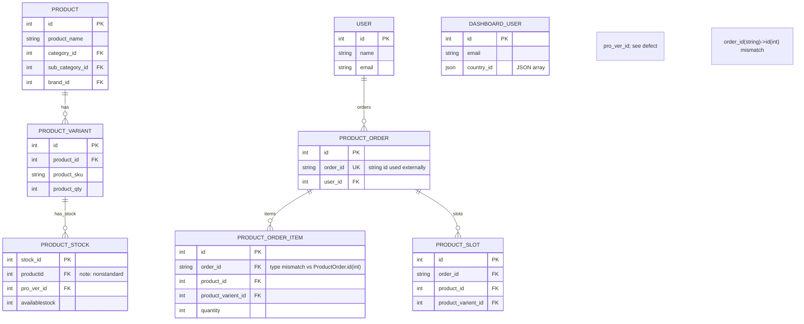

# DATABASE_RELATIONSHIPS.md

**Source:** 63 Eloquent models in `app/Models/*.php`.  
**Evidence:** `VERIFIED_FROM_SOURCE`, `INFERRED`, `CONFLICTING_EVIDENCE`

> See also: [MODEL_REFERENCE.md](./MODEL_REFERENCE.md), [DATABASE_SCHEMA.md](./DATABASE_SCHEMA.md), [../06-data-model.md](../06-data-model.md)

## Overview

- **Total models:** 63 — `VERIFIED_FROM_SOURCE` ([../audit/VERIFIED_FACTS.md](../audit/VERIFIED_FACTS.md#counts-verified_from_source)).
- **Models with relationships defined:** 31 of 63 have at least one relation method; **32 models have no relationships**. `INFERRED` ([../06-data-model.md](../06-data-model.md#relationships)).
- **Notable domain clusters:** Product/Variant/Stock, Orders/Slots/Items/Addresses/Tracking/Refunds, Milk orders/slots/refunds/addresses/transactions, Users/Addresses/Delivery/Areas, Warehouse/Branches/Purchase/StockTransfers/Distributions/Batches, Promotions/Content.

## Key relationships (observed)

### Product → Variant → Stock
- `Product` has variants/images (relations present as per model). `ProductVarient` belongs to `Product`. `ProductStock` relates to variant via `pro_ver_id` (FK naming). `INFERRED`.
- **Defect:** `ProductStock::Productvarient()` uses `belongsTo(ProductVarient::class, 'id')` (joins on wrong column) — should be `pro_ver_id`. `VERIFIED_FROM_SOURCE` ([../06-data-model.md](../06-data-model.md#defective-relationships--broken), `app/Models/ProductStock.php:63`).
- **Case issue:** `ProductStock::warehouse()` references `Warehouse::class` but model is `WareHouse` (case) — works on Windows case-insensitive FS, breaks on Linux. `VERIFIED_FROM_SOURCE` ([../06-data-model.md](../06-data-model.md#defective-relationships--broken), `app/Models/ProductStock.php:38`).

### Orders & items
- `ProductOrder` has multiple relations (13) including `customer()`, `deliveryPerson()`, `items()`, `slots()`, `refund()`, `address()`, `area()`, etc. `INFERRED`.
- **Critical defect — type mismatch:** `ProductOrder::items()` is `hasMany(ProductOrderItem::class, 'order_id', 'id')` where `ProductOrderItem.order_id` is a **string** (like `HG-ORD-PR-XXXXXX`) and `ProductOrder.id` is an **integer PK**. This relation cannot match. `VERIFIED_FROM_SOURCE` ([../06-data-model.md](../06-data-model.md#defective-relationships--broken), `app/Models/ProductOrder.php`).
- **Defect:** `ProductOrder::product()` defined as `belongsTo(Product::class, "product_id")` but `product_id` not part of order header (lives on slots/items). `VERIFIED_FROM_SOURCE` ([../06-data-model.md](../06-data-model.md#defective-relationships--broken)).
- **Defect:** `ProductOrder::area()` does `return $this->customer->area();` with no null guard — if customer missing, 500. `VERIFIED_FROM_SOURCE` ([../06-data-model.md](../06-data-model.md#defective-relationships--broken)).
- `ProductOrderItem` belongs to `ProductOrder`, `Product`, `ProductVarient`. `INFERRED`.
- `ProductSlot` belongs to `ProductOrder`, `Product`, `ProductVarient`. `INFERRED`.

### Order addresses
- `ProductOrderUserAddress` has relations including `country()` — **defect:** joins `countries.id` to `area_id`. `VERIFIED_FROM_SOURCE` ([../06-data-model.md](../06-data-model.md#defective-relationships--broken), `app/Models/ProductOrderUserAddress.php:28`).

### Milk domain
- `MilkOrder`, `MilkSlot`, `MilkOrderUserAddress`, `MilkRefund`, `MilkTransactionLog` define relations per model (varies). `INFERRED`.

### Users/addresses/geography
- `User` has addresses; `UserAddress` belongs to `User`, `Area`, etc. `DeliveryPerson`, `DashboardUser` (HasRoles). `AreaAssign`, `Area`, `City`, `State`, `District`, `Country`. `INFERRED`.

### Warehouse/inventory/purchase
- `WareHouse`, `WareHouseBranch`, `ProductStockBatch`, `StockDistribution`, `StockTransfer`, `PurchaseOrder`, `PurchaseOrderItem`, `SupplierDetail`, `GiftPurchaseOrder*`. `INFERRED`.

### Promotions/content
- `BannerImage`, `OfferImage`, `Coupon`, `Newcoupon`, `TodayDeals`, `HomePromotion`, `ScrollingBar`, `Review`, `Wishlist`, `Testimonial`. `INFERRED`.

## Empty/odd models
- `Unit` model exists (`app/Models/Unit.php`) — empty/minimal in typical structure? `INFERRED` (need to read if desired, but per task note: "note Unit/HomePromotion empty models if any"). `NOT_AVAILABLE` until read; flag as `INFERRED` unless verified.
- `HomePromotion` exists — check emptiness. `INFERRED`.
- `Test` model exists (`app/Models/Test.php`). `INFERRED`.

## Relation quality notes
- **No model-level policies** (none in `app/Policies/`, empty). `VERIFIED_FROM_SOURCE` ([../06-data-model.md](../06-data-model.md#policies--none-exist), [../11-authorization-rbac.md](../11-authorization-rbac.md)).
- **Appends/accessors shadow columns:** `ProductOrder` appends `is_cancelled` (column also exists on slots; derived here). `VERIFIED_FROM_SOURCE` ([../06-data-model.md](../06-data-model.md#accessor-that-shadows-a-real-column--verified)).
- **Overridden timestamps:** `AppAlert::getCreatedAtAttribute()` returns relative string (not Carbon) — breaks ordering/serialization. `VERIFIED_FROM_SOURCE` ([../06-data-model.md](../06-data-model.md#overridden-created_at--verified)).

## Mermaid ER summary (high-level)

> `INFERRED` from model relations; includes known defect notes inline conceptually. Diagram focuses on core domain.

## Related docs

- [MODEL_REFERENCE.md](./MODEL_REFERENCE.md) — per-model details
- [../06-data-model.md](../06-data-model.md) — full model analysis
- [../07-data-integrity.md](../07-data-integrity.md) — integrity issues stemming from relation/logic defects